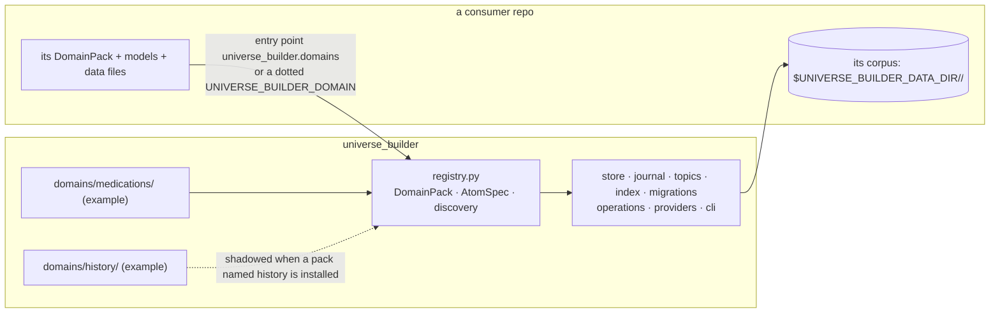
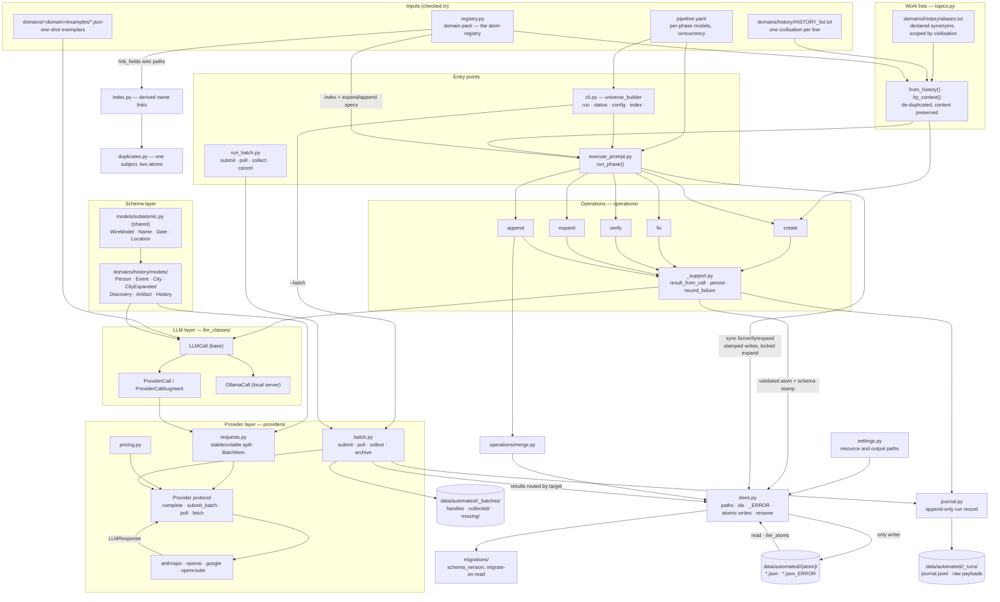

# universe_builder — architecture

## 0. What this is, and where history went

`universe_builder` is the **engine**: a pipeline that turns a domain's seed
list into a corpus of validated JSON files, one per subject, using LLMs — and
the tools that keep such a corpus honest (index, lint, duplicates, collisions,
sources, costs, retire). It knows no domain. What it generates is
declared by a **domain pack** (`registry.DomainPack`): the Pydantic models, the
index atom that lists the work, the prompts and examples, and the handful of
tables the curation verbs read (evidence paths, preferred hosts, resolvers,
stopwords, a persona). Two packs ship here as worked examples:

- `domains/medications/` — the minimal pack: one index, one atom, an expand
  and an append. Read this one to write your own.
- `domains/history/` — the richer pack: nine atom types, a second on-disk
  shape, link paths, evidence paths, an alias file, a domain operation and a
  free resolver. **It is an example, fixed in place.** Its code follows a
  real pack; its tables are small samples written by hand, never copied from
  a live pack (`tests/test_no_live_data.py`). A pack installed under the
  `universe_builder.domains` entry point is tried *before* the bundled one.

**Candidates for core, waiting on a second domain.** The
history pack's Wikimedia enrichment (`wikimedia.py`, a throttled HTTP door;
`wikipedia.py`, the resolvers this engine already offers as `--via
wikipedia`; `signals.py`, pageviews and link counts per atom into a
sidecar under `_index`; `media.py`, a licence-checked lead image per atom
into a `_media` folder beside the atoms) is almost entirely domain-free: Wikipedia is not history
knowledge, and a medications pack would want the same numbers and the same
photo per drug. It stays in that pack until a second domain asks, because
each change there would otherwise be a tag bump here and a pin bump there
while the code is new. When it moves: `wikimedia.py` first (pure
transport), then the resolvers, then `signals` and `media` as core verbs
parameterised by three pack fields (a summary path, a stop-list path, and
the `date_paths` packs already declare). `tests/test_pack_contract.py`
catches a history string leaking in. `DomainPack.operations` with
`OperationSpec` (v0.1.10) is what lets the pack hold them meanwhile.

**How a pack reaches the engine** (`registry._discover`, in order): already
registered in this process; a dotted module path in `UNIVERSE_BUILDER_DOMAIN`
(the module registers itself on import); an entry point in the
`universe_builder.domains` group named for the pack; the bundled
`domains/<name>`. An entry point's name must equal the name its module
registers, and a builder-style target must not also self-register.

**Where data goes.** `UNIVERSE_BUILDER_DATA_DIR`, else `./data/automated` under
the working directory — never under the package — plus the domain's name. The
nearest `.env` is loaded from the working directory upward, then from the
package upward; the first found wins.

**What the rest of this document is.** It was written while the engine and a
history pack were one tree, and describes every mechanism through the history
example; where it says "the corpus" it means the corpus a pack generates. The
mechanics are accurate for any pack; the history-specific prose is being cut
down section by section as each is touched.

## 1. The big picture

---

## 2–7. The parts

Everything after §1 lives in one file per area under `docs/architecture/`,
headings and § numbers unchanged, so a citation like "ARCHITECTURE §2.1e"
in the code is found in the row below. Keeping the doc current means
editing the part a change touches; add a row here only for a new part.
`tests/test_architecture_doc.py` reads this file and every part.

| § | Part | What it covers |
|---|---|---|
| 2.1 | [`2.1-schema.md`](docs/architecture/2.1-schema.md) | Atom models, `subatomic` shared models, `EmptyModel`; the class diagram |
| 2.1b | [`2.1b-store.md`](docs/architecture/2.1b-store.md) | `store.py`, the only writer: paths, names, ids, writes; 2.1b-i wire aliases |
| 2.1c | [`2.1c-registry.md`](docs/architecture/2.1c-registry.md) | `atoms.py`, `config.py`, `operations/`: the registry, `Result`, in-place rewrites |
| 2.1d | [`2.1d-migrations.md`](docs/architecture/2.1d-migrations.md) | `migrations/`: schema versions, migrate-on-read, `migrate` |
| 2.1e | [`2.1e-journal.md`](docs/architecture/2.1e-journal.md) | `journal.py`: the append-only run record, attempts, replaced bytes, `restore` |
| 2.1f-i | [`2.1f-i-coverage.md`](docs/architecture/2.1f-i-coverage.md) | `status --coverage` |
| 2.1f-ii | [`2.1f-ii-index.md`](docs/architecture/2.1f-ii-index.md) | `index.py`, `universe_builder index`: cross-references |
| 2.1f-iv | [`2.1f-iv-retire.md`](docs/architecture/2.1f-iv-retire.md) | `retire.py`: superseded atoms to `_retired/` |
| 2.1f-iii-a | [`2.1f-iii-a-duplicates.md`](docs/architecture/2.1f-iii-a-duplicates.md) | `duplicates.py`: atoms that share a name, triage, `--via model` |
| 2.1f-iii-b–d | [`2.1f-iii-lint.md`](docs/architecture/2.1f-iii-lint.md) | `lint.py`: contradicting identity files, disowned topics, shared aliases (b, c, d) |
| 2.1f-v | [`2.1f-v-periods.md`](docs/architecture/2.1f-v-periods.md) | History pack's `periods.py`, `universe_builder periods` |
| 2.1f | [`2.1f-topics.md`](docs/architecture/2.1f-topics.md) | `topics.py`: work lists, alias files, grouping |
| 2.1g | [`2.1g-experiments.md`](docs/architecture/2.1g-experiments.md) | `experiments.py`, `prompt_spec.py`, `experiment_stats.py`: prompt A/B |
| 2.2 | [`2.2-llm-classes.md`](docs/architecture/2.2-llm-classes.md) | `llm_classes/`: one prompt builder (`build_request`), `ProviderCall` |
| 2.2b | [`2.2b-pipeline-config.md`](docs/architecture/2.2b-pipeline-config.md) | `pipeline.yaml`, `pipeline.py`: tiers, model resolution, effort, task budget |
| 2.2b | [`2.2b-cli.md`](docs/architecture/2.2b-cli.md) | `cli.py`: wrappers (`prog=`), where verb logic lives, the verb table, why no second source API |
| 2.2b | [`2.2b-cli-runs.md`](docs/architecture/2.2b-cli-runs.md) | `run`: `--dry-run`, the six phases, tiers not models |
| 2.3 | [`2.3-orchestration.md`](docs/architecture/2.3-orchestration.md) | `execute_prompt.py` |
| 2.5 | [`2.5-providers.md`](docs/architecture/2.5-providers.md) | `providers/`: streaming, refusals, retries, effort and task budget on the wire |
| 2.5 | [`2.5-batch.md`](docs/architecture/2.5-batch.md) | Batching a phase: submit, collect, chunking, credentials, structured output, caching |
| 2.5 | [`2.5-providers-usage.md`](docs/architecture/2.5-providers-usage.md) | Using the provider layer: one call, effort, task budget, batch, adding a provider; caveats |
| 2.4 | [`2.4-helpers.md`](docs/architecture/2.4-helpers.md) | Where `functions/` went (v0.3.0) |
| 3 | [`3-passes.md`](docs/architecture/3-passes.md) | The pipeline, pass by pass; the sequence diagram |
| 4 | [`4-errors.md`](docs/architecture/4-errors.md) | Error handling: concurrent writers, failed augments, truncation |
| 5 | [`5-config.md`](docs/architecture/5-config.md) | Configuration and conventions: runtime config, secrets, paths, pricing, batch handles, CI |
| 6 | [`6-extending.md`](docs/architecture/6-extending.md) | Extending: a new atom type, domain, model or provider; what a pack may import |
| 6b | [`6b-tests.md`](docs/architecture/6b-tests.md) | Tests: markers, no network, the `workspace` fixture, packaging checks |
| 7 | [`7-constraints.md`](docs/architecture/7-constraints.md) | Known constraints and fixed defects (B-numbers) |
