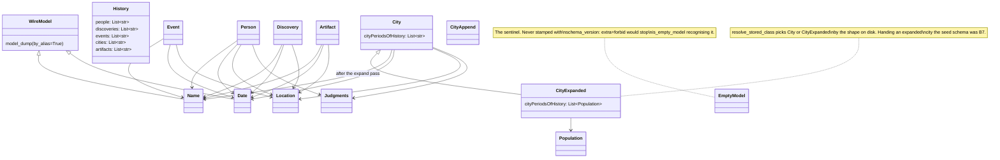

Part of [ARCHITECTURE.md](../../ARCHITECTURE.md); the index there lists every part.

### 2.1 Schema layer — `src/universe_builder/models/subatomic.py` + each domain's models

Pydantic models are the source of truth. The **shared primitives** live in core
`models/subatomic.py` (`Name`, `Date`, `Location`, `Judgments`, `Certainty`,
`WireModel`, `EmptyModel`) — every domain builds on them. The **atom models** are
the domain's own: history's are in `src/universe_builder/domains/history/models/`,
medications' in `src/universe_builder/domains/medications/
models.py`. Core carries no atom shapes, only the primitives. They are used three ways: to generate the JSON
schema injected into the prompt, to validate the model's reply, and to serialise the
result to disk.

| Module | Model | Notes |
|---|---|---|
| `history.py` | `History` | Five lists of topic strings (`people`, `discoveries`, `events`, `cities`, `artifacts`). This is the seed atom — everything else fans out from it. |
| `person.py` | `Person` | Plus `Birth`, `Death`, `Family`, `Reason`. |
| `event.py` | `Event` | Plus `Start`, `End`. |
| `city.py` | `City`, `CityAppend` | Plus `Population`, `CityDate`, `GeographyAndClimate`, `MonthlyClimate`. `CityAppend` is the schema for the append pass. |
| `discovery.py` | `Discovery` | Plus `Finding`. |
| `artifact.py` | `Artifact` | |
| `subatomic.py` | `Name`, `Date`, `Location`, `Judgments`, `EmptyModel` | Shared building blocks, reused across every atom. |

`subatomic.Date` carries the defensive coercions that keep LLM output validatable:
negative years become absolute — and a negative year with no era becomes BCE,
since the sign was its only record (a negative year with an explicit `CE` keeps
its era and is logged) — month names and out-of-range months become
`None`, and out-of-range days become `None`. `EmptyModel` is the sentinel written when a response
cannot be validated.

`subatomic.Name.otherNames` carries a rule rather than a label, and the rule is
**on the field on purpose** — a description rides the schema on every path
(create, fix, verify, expand, batch), so it cannot drift between prompt copies
the way a line in `prompts/` can. It admits other-language forms, historical
names, transliteration variants and a place's modern name; it excludes the
common name with a qualifier bolted on, and it excludes a *different subject
with a similar name*. Both exclusions are observed failures, not hypotheses:
under the previous one-line description the bundled examples put `"Ancient
Memphis"` and `"Tamerlane"` — a man who died 178 years after Genghis Khan — in
this list. The field is read back by `topics.stored_name_claims` (§2.1f-ii), so
a wrong entry is a claim the resolver may act on rather than dead prose.

**The description is not the enforcement.** A run of `gpt-5-nano` creates
showed what the rule actually buys: the `"Ancient X"` padding
stopped, but two faults survived it — an entry repeating the atom's own
`common` name, and a trailing gloss (`"Maatkare (throne name)"`). Writing both
into the description changed nothing; the two subjects were re-run and nano
reproduced the repeat and the gloss every time.
Both faults are mechanical, so `Name._tidy_other_names` now decides them in a
`model_validator` instead: it drops an entry equal to `common`, strips a
trailing parenthetical, and de-duplicates case-insensitively — coercing rather
than rejecting, the judgement `_lower` already makes for a capitalised
`certainty`. The strip fires only on the `_NAME_DESCRIPTORS` vocabulary, so
`"Abidos (Greek)"` loses its aside and `"Thebes (Luxor)"` — one place under two
names — keeps its brackets. That asymmetry is deliberate: a wrong strip deletes
a name irrecoverably, a missed one leaves work for `universe_builder lint`. Because it runs
at validation, a stored atom is tidied when it is next rewritten; nothing on
disk changes until then.

